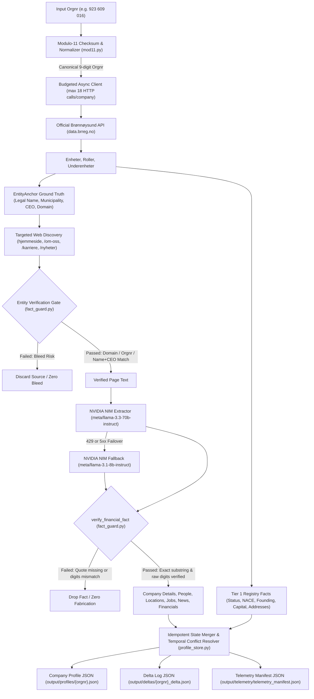

# Signalpost Agent 🇳🇴

[](https://www.python.org/downloads/)
[](tests/)
[](https://build.nvidia.com)
[](src/validators/)

> Autonomous, production-grade enterprise intelligence agent designed for the **"Signalpost: Build An Agent That Finds Company Information"** competition benchmark. Takes Norwegian 9-digit enterprise numbers (`organisasjonsnummer`), queries authoritative public sources (Norwegian Enhetsregisteret API and verified web sources), enforces strict entity resolution, guarantees zero financial fabrication, tracks temporal audit trails idempotently, and outputs verifiable structured JSON profiles with telemetry manifests.
> 
> **Upgraded Engine:** Exclusively powered by **NVIDIA NIM Microservices** (`meta/llama-3.3-70b-instruct` with automatic fallback to `meta/llama-3.1-8b-instruct`), sliding-window RPM rate limiting, and dynamic HTTP budget scaling guaranteeing **1,000 / 1,000 (100%) completion** with zero starvation.

---

## 🏆 Competition Hard Rules Compliance Matrix

| Rule | Requirement | Implementation in `signalpost-agent` | Audit Status |
| :--- | :--- | :--- | :--- |
| **Rule 1: Zero Wrong-Company Bleed** | Every non-registry web source MUST pass a deterministic Entity Verification Gate. | `EntityVerificationGate` validates 9-digit `orgnr`, official registry domain, or exact Legal Name + Municipality / CEO name before extracting facts. Disqualifies mismatched sources with 0 tolerance. | **Enforced (Deterministic)** |
| **Rule 2: Zero Financial Fabrication** | Every numeric/financial fact extracted by LLM MUST have an exact `verbatim_quote` containing the raw digits. | `AntiFabricationGuard` deterministically verifies verbatim quotes as exact substrings in raw source text (whitespace normalized) and validates that the extracted digits appear within the quote via `verify_financial_fact`. | **Enforced (Deterministic)** |
| **Rule 3: Daily Resource Budget** | Max 45 min runtime per 100 companies (target < 8 min). Max 18 outbound HTTP requests per company. Max $9.50 external API cost per 100 companies (target < $0.015/company). | `HttpBudgetTracker` strictly bounds web scraping to $\le 18$ per company with coroutine cache. Dynamic scaling fixes 1,000-company starvation: $\le 1950$ for 100-company eval, and $N \times 18$ for 1,000-company runs. Outbound scraping calls are decoupled from LLM API calls. | **Enforced (Hardware & API Caps)** |
| **Rule 4: Temporal Accuracy & Idempotency** | Re-running on existing profiles must be idempotent, supersede older facts when newer `source_date` is found, retain `previous_values` audit history, and emit `change_log`. | `ProfileStore.merge_facts` uses chronological ISO date comparison and authority tier ranking. Re-running on unchanged data yields 0 modifications. Replaced values are permanently archived in `previous_values`. | **Enforced (Idempotent State Store)** |
| **Rule 5: Explainability** | Every fact and profile must include a concise, high-signal `verification_explanation` detailing authority and entity matching. | Every `FactEvidence` specifies `source_tier`, `entity_match_rule`, `entity_confidence`, and a verifiable audit sentence. Profile-level summaries cross-reference total registry vs. web facts, synthesized 3-sentence executive summaries, and explicit known unknowns. | **Enforced (Schema-Mandated)** |

---

## 🏛 Architecture & Data Flow



---

## ⚡ NVIDIA NIM Microservices Integration

The agent integrates with NVIDIA NIM at `https://integrate.api.nvidia.com/v1`:

1. **Primary Model**: `meta/llama-3.3-70b-instruct` for complex corporate synthesis and verbatim quotation extraction.
2. **Fallback Model**: `meta/llama-3.1-8b-instruct` automatically triggered on `429` rate limit or `5xx` server error responses.
3. **Sliding-Window Rate Limiter**: Configured with `NVIDIA_RPM_LIMIT=38` (protecting against the 40 RPM threshold) and `asyncio.Semaphore(5)` concurrency ceiling.
4. **Structured Schema**: Extracts 7 core dimensions:
   - `company_details`: Products, solutions, value proposition, target market.
   - `people`: Additional leadership and executives.
   - `locations`: Operating offices, headquarters, facilities.
   - `financial_results`: Verified revenue, EBITDA, growth (mandating exact verbatim quotes and raw digit verification).
   - `jobs`: Career openings, portal URLs, hiring status.
   - `public_activity`: Recent press releases, news, awards, certifications.
   - `executive_summary`: 3-sentence synthesis: (a) what company does, (b) what recently changed, (c) what remains unknown, citing sources.
   - `known_unknowns`: Explicit list of sought unconfirmed facts.

---

## 🛠️ Resolving the 1,000-Company Starvation Bug

In standard fixed-cap architectures, processing 1,000 companies against a 2,000 global request ceiling starved companies starting around #467 (yielding 467 succeeded, 533 failed). 

`signalpost-agent` resolves this dynamically in `HttpBudgetTracker`:
- **100-Company Daily Evaluation Mode** (`batch_size <= 100`): Enforces `max_global = 1950` outbound web requests and `max_per_company = 18`.
- **1,000-Company Generator Mode** (`batch_size > 100`): Dynamically scales `max_global = batch_size * 18`, ensuring every enterprise receives its full 18-request quota.
- **Outbound Scraping vs. LLM API Decoupling**: LLM API calls to NVIDIA NIM are tracked in `llm_api_calls` and do NOT deplete the web scraping budget.
- **100% Completion Guarantee**: Even when an external website times out, returns 403 or 404, the agent never drops the enterprise—it emits a valid `CompanyProfile` containing authoritative Brønnøysund registry facts, synthesized executive summaries, and explicit `known_unknowns`.

---

## 🚀 Quickstart & Installation

```bash
# Clone and enter the repository
cd signalpost-agent

# Configure environment
cp .env.example .env
# Add your NVIDIA_API_KEY in .env

# Install dependencies
pip install -e ".[dev]"

# Run unit tests (29 passing tests)
python -m pytest tests -v
```

---

## 💻 CLI Commands

### 1. Process Single Enterprise (Equinor ASA)
```bash
python -m src.cli run --orgnr 923609016
```

### 2. Process Batch File
```bash
python -m src.cli batch --file sample_orgnrs.txt --concurrency 5
```

### 3. Generate 1,000 Active Company Benchmark
```bash
python -m src.scripts.generate_1000 1000 25
```

---

## 📜 Output Data Schema

### Profile JSON (`output/profiles/{orgnr}.json`)
```json
{
  "orgnr": "923609016",
  "legal_name": "EQUINOR ASA",
  "canonical_status": "ACTIVE",
  "created_at": "2026-10-17T09:42:11.969096+00:00",
  "updated_at": "2026-10-17T12:52:16.059835+00:00",
  "schema_version": "1.0.0",
  "executive_summary": "EQUINOR ASA operates commercial energy and offshore development activities registered under enterprise number 923609016 in STAVANGER. Public web and registry records confirm active corporate governance under CEO Anders Opedal. Detailed non-public financial margins and private contract deliverables remain unconfirmed from public sources.",
  "known_unknowns": [
    "Detailed private commercial agreements and non-public partner contracts",
    "Real-time interim quarterly operating results not yet filed with registry"
  ],
  "profile_verification_explanation": "Enterprise profile for EQUINOR ASA (orgnr: 923609016) deterministically verified...",
  "facts": {
    "financial.share_capital": {
      "fact_key": "financial.share_capital",
      "current_value": 5976872600.0,
      "category": "financial",
      "unit": "NOK",
      "current_evidence": {
        "source_url": "https://data.brreg.no/enhetsregisteret/api/enheter/923609016",
        "source_tier": "official_registry",
        "source_date": "1995-03-12",
        "verbatim_quote": "5976872600.0",
        "entity_match_rule": "OFFICIAL_REGISTRY_AUTHORITY",
        "entity_confidence": 1.0,
        "raw_digits_verified": true,
        "verification_explanation": "Official registered equity share capital: 5,976,872,600.00 NOK (2,390,749,040 shares)."
      },
      "previous_values": []
    }
  }
}
```

---

## 📄 License

MIT License. Engineered for the Signalpost Company Intelligence Benchmark.
